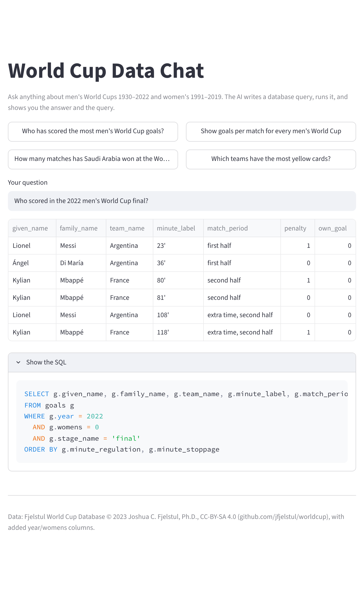
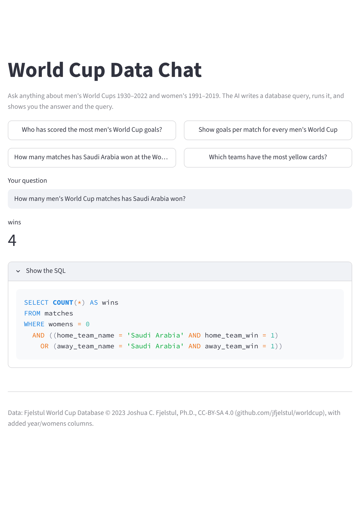
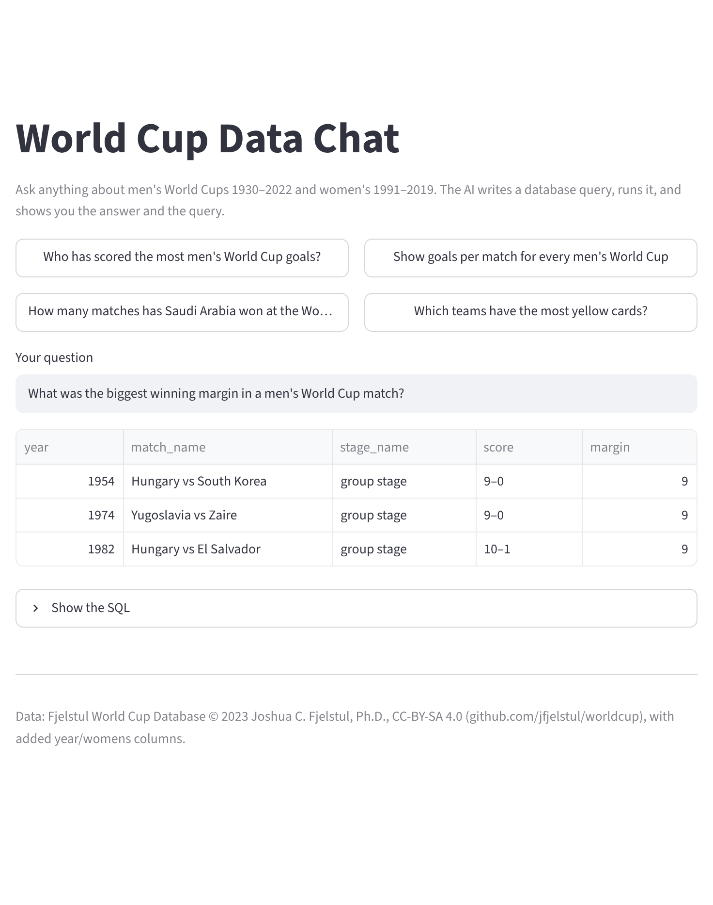

# World Cup Data Chat ⚽💬

**Ask any question about World Cup history in plain English and get the answer from real match data, with the exact database query behind it.**

*"How many World Cup matches has Saudi Arabia won?"* · *"Who scored in the 2022 final?"* · *"Which World Cup had the most goals per match?"*

An AI model reads the question, writes a SQL query against a database of **every World Cup match since 1930**
(1,248 matches, 3,637 goals, 10,401 players, 3,178 cards), runs it safely and shows the result as a number, a table
or a chart. The query is always one click away, so every answer can be checked rather than trusted.

On a hand-written test set of 50 questions it answers **50 / 50 correctly** ([how that was measured](#accuracy)).



---

## Contents

- [Quick start](#quick-start)
- [What it looks like](#what-it-looks-like)
- [How it works](#how-it-works) ← the interesting part
- [Accuracy](#accuracy)
- [Limitations](#limitations): read before trusting an answer
- [Project layout](#project-layout) · [Data and licence](#data-and-licence)

---

## Quick start

```bash
git clone https://github.com/Mohammed-890/worldcup-data-chat.git && cd worldcup-data-chat
python3 -m venv .venv && source .venv/bin/activate
pip install -r requirements.txt
streamlit run app.py          # opens http://localhost:8501
```

The database (`data/worldcup.db`) is committed, so there is nothing to download. To rebuild it from the
source CSVs, run `./get_data.sh`.

**Which AI model does it use?** It picks a backend automatically:

| If… | It uses |
|---|---|
| `OPENROUTER_API_KEY` is set | [OpenRouter](https://openrouter.ai) (one key, many models). Choose one with `WC_MODEL`, default `anthropic/claude-sonnet-4.5` |
| otherwise, the [Claude Code](https://claude.com/claude-code) CLI is installed and logged in | `claude -p`, so no API key is needed |

```bash
python3 -m pytest -q tests            # unit tests, no model or key needed
python3 eval/run_eval.py              # re-run the 50-question accuracy test
```

---

## What it looks like

**A single number becomes a headline figure.** The SQL shows exactly what was counted (home *and* away wins, men's only):



**Ties are not hidden.** Asked for "the biggest winning margin", it returns all three matches won by 9 goals, not just the first one it finds:



A bar chart is drawn only when it means something: one real measure, distinct labels and values that differ.
Years, minutes, rankings and 0/1 flags are never charted.

---

## How it works

```
question ──► prompt (schema + data notes) ──► model ──► SQL ──► safety check ──► read-only SQLite ──► table / number / chart
                                                ▲                                       │
                                                └──── error message, one retry ◄────────┘
```

### 1. A database built for questions

The [Fjelstul World Cup Database](https://github.com/jfjelstul/worldcup) is loaded into 10 SQLite tables: matches,
goals, players, appearances, bookings, awards, standings, stadiums, teams and tournaments. Two columns are added to every
tournament-level table: `year` and `womens` (0 = men's, 1 = women's). Without them, "the 2014 World Cup" needs a join and a
string match on the tournament name, and that is exactly where models make mistakes.
→ [`src/build_db.py`](src/build_db.py)

### 2. Tell the model about the data's quirks

The model gets the schema, the exact allowed values for tricky columns (stage names, award names, match periods), and short notes on traps that a correct-looking query
would fall into:

- **Own goals** are stored against the scorer but credited to the other team. Counting "Klose's goals" without
  excluding them gives the wrong total.
- **Penalty goals vs shootouts:** `penalty = 1` means a penalty in play. Shootout kicks aren't goals.
- **Scores are text** (`'3–3'` with an en dash), so maths has to use `home_team_score` and `away_team_score`.
- **One-name players** like Marta have `given_name = 'not applicable'`.
- **Ambiguity:** if a question doesn't say men's or women's, assume men's.

→ [`src/agent.py`](src/agent.py)

### 3. Safe by design

The model's SQL is untrusted text, so:

- the database is opened **read-only** (`mode=ro&immutable=1`), so even a bad query cannot change it
- only a **single `SELECT` / `WITH`** statement is accepted. `DROP`, `UPDATE`, `ATTACH`, `PRAGMA` and stacked
  statements are refused before they run
- results are capped at 200 rows

### 4. Self-correction

If the query errors (a wrong column name, say), the model is shown the error message and gets **one** retry. One is
enough to fix typos without letting a confused model loop forever.

---

## Accuracy

[`eval/questions.py`](eval/questions.py) holds **50 questions, each with a hand-written correct SQL query**. The
answers were checked against known facts: Klose 16 goals, Messi 13, Brazil 5 titles, Morocco 4th in 2022,
1954 = 5.38 goals per match. The questions cover winners, top scorers, awards, cards, hosts, own goals, shootouts,
hat-tricks, records and the women's tournament.

[`eval/run_eval.py`](eval/run_eval.py) asks the app every question and compares its rows with the correct ones
([`src/compare.py`](src/compare.py)). An answer counts as correct when **every expected value is present and no
returned row is wrong**. Column order, row order, extra columns and repeated rows are all allowed, so an answer that
names Messi once per goal, or lists every match tied for a record, still counts.

| Model | Correct |
|---|---|
| Claude (via Claude Code CLI) | **50 / 50 (100%)** |

**Testing the tester.** The first run scored 47/50. All three "misses" turned out to be *right* answers that the
first version of the checker rejected for having more rows than expected: three matches tied for the biggest win, a
player scoring twice in a final, five goals all scored in the 1st minute. The checker was fixed and the saved answers
re-scored. No questions or answers were changed to raise the score.

---

## Limitations

- **50 questions is a small test.** A perfect score means it is reliable on common questions, not that it is never
  wrong. Odd phrasings, multi-step questions and anything needing outside knowledge are harder.
- **It only knows what is in the data.** Men's World Cups 1930–2022 and women's 1991–2019. The 2026 tournament isn't
  in the source yet, and there is nothing on qualifiers, transfers or club football.
- **A wrong answer can look right.** That is why the SQL is always shown. If an answer matters, check the query.
- **Questions go to the model.** Each question is sent to an AI provider (OpenRouter or Anthropic via Claude Code).
  The data itself never leaves your machine.

---

## Project layout

```
app.py                 Streamlit interface: examples, answer display, chart rules, SQL panel
src/agent.py           prompt, model backends, SQL safety check, read-only execution, retry
src/build_db.py        CSVs → data/worldcup.db (adds year / womens columns)
src/compare.py         how an answer is judged correct
eval/questions.py      50 questions with hand-written correct SQL
eval/run_eval.py       runs the accuracy test and saves every answer to eval/results_<model>.json
tests/test_core.py     tests: every gold query runs, known facts, safety check, answer comparison, retry
data/raw/              source CSVs        data/worldcup.db    the built database
docs/                  screenshots
```

---

## Data and licence

Fjelstul World Cup Database © 2023 Joshua C. Fjelstul, Ph.D., licensed
[CC-BY-SA 4.0](https://creativecommons.org/licenses/by-sa/4.0/legalcode),
[github.com/jfjelstul/worldcup](https://github.com/jfjelstul/worldcup).
Modified here: id and link columns removed, `year` and `womens` added. The database file in this repo is therefore also
CC-BY-SA 4.0.
